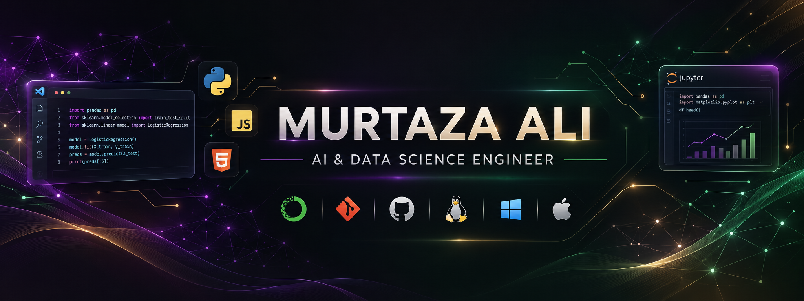
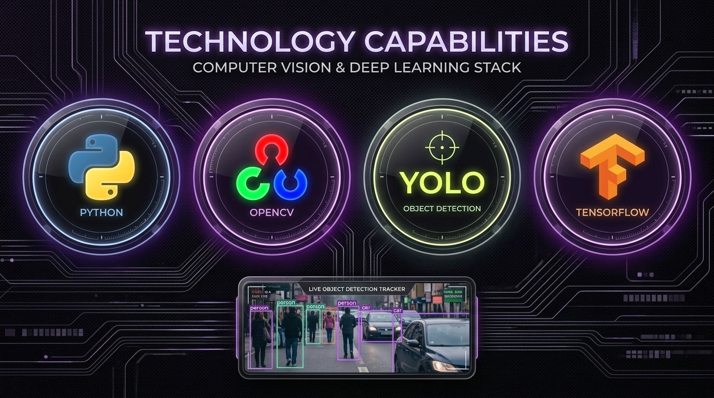
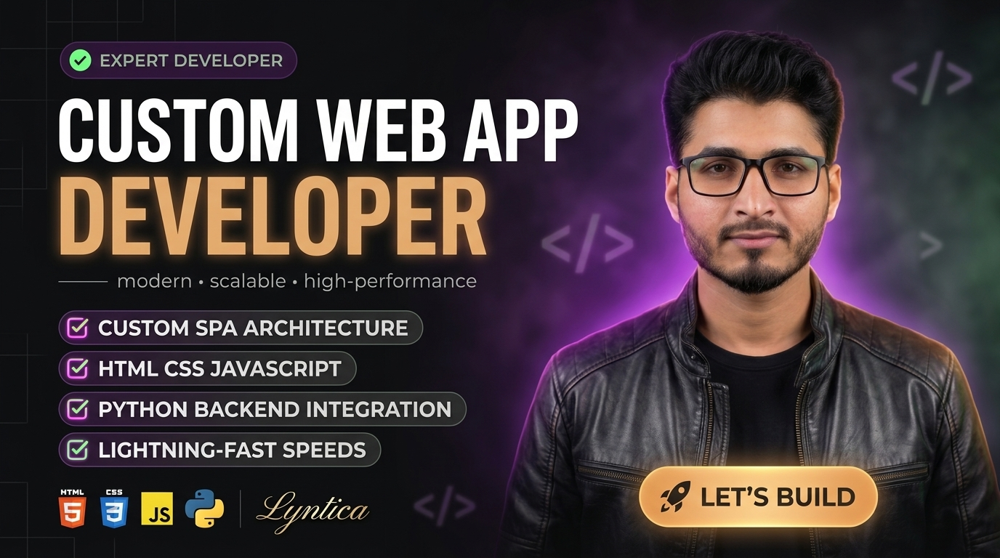
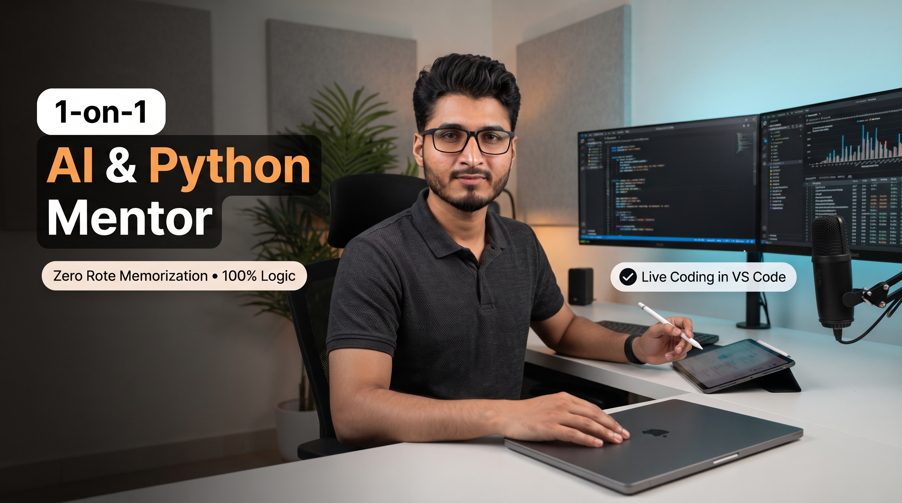
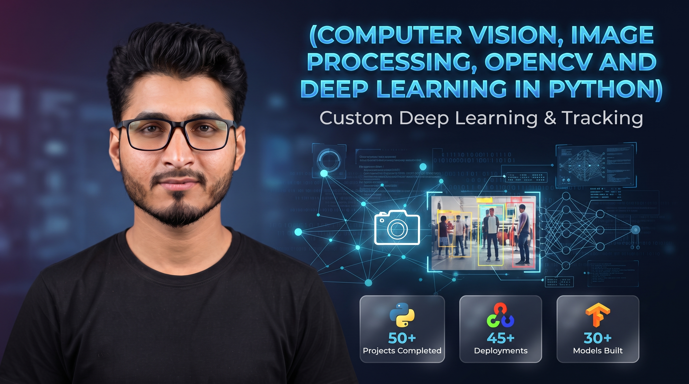
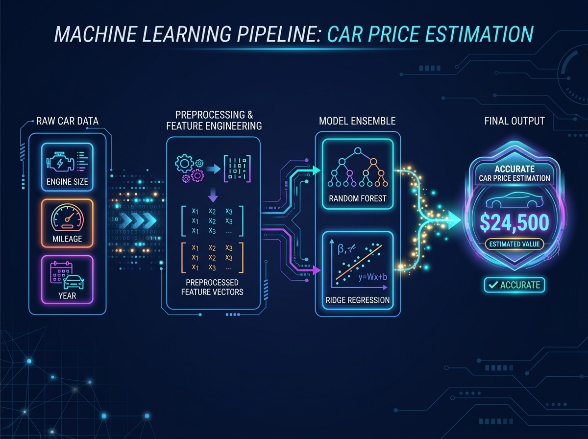
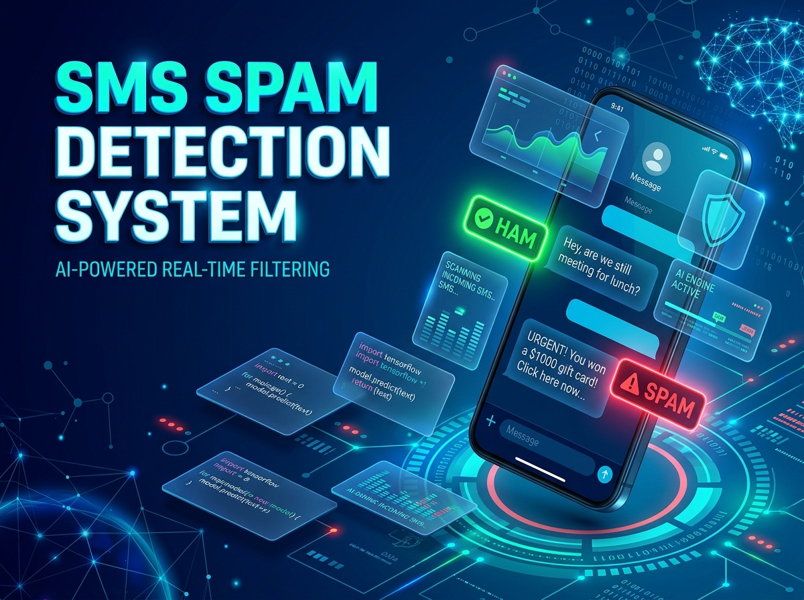
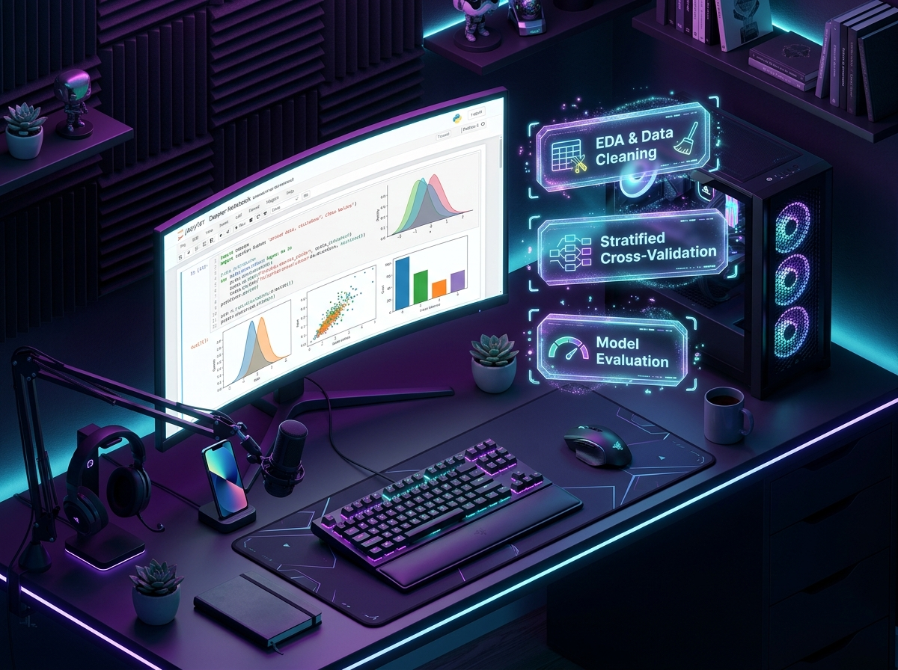
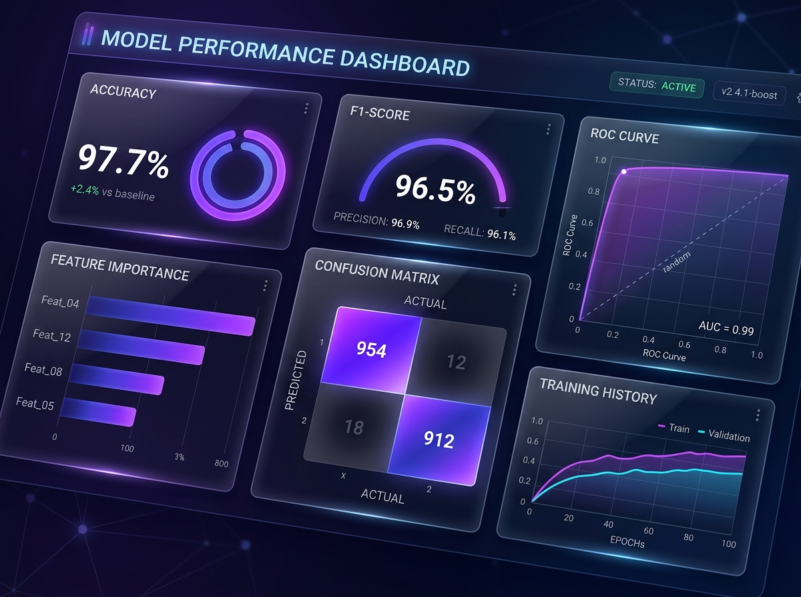

<p align="center">
  <a href="https://www.murtazaalikhan.com" target="_blank">
    
  </a>
</p>

<p align="center">
  <a href="https://www.murtazaalikhan.com" target="_blank">
    
  </a>
  <a href="https://linkedin.com/in/murtazakhanworld" target="_blank">
    
  </a>
  <a href="https://kaggle.com/murtazakhanpro" target="_blank">
    
  </a>
  <a href="mailto:murtazakhan.mzk@gmail.com">
    
  </a>
  <a href="https://wa.me/?text=Hi%20Murtaza%2C%20I%20reviewed%20your%20portfolio%20(murtazaalikhan.com)%20and%20GitHub%20profile.%20I%20would%20like%20to%20connect%20with%20you." target="_blank">
    
  </a>
</p>

<p align="center">
  
  
  
  
</p>

<p align="center">
  <a href="https://www.murtazaalikhan.com" target="_blank">
    
  </a>
</p>


---

### 🌐 System Overview & Engineering Philosophy

> **"Code is ephemeral; mathematical logic and architectural determinism endure."**

I am an **Applied AI & Full-Stack MLOps Engineer** specializing in productionizing deep learning vision models, high-concurrency Python architectures, and self-healing data pipelines. Currently serving as **Lead Data Scientist at Lyntica**, I translate non-deterministic machine learning experiments into deterministic, low-latency enterprise software systems.

* ⚙️ **Core Focus**: End-to-end Machine Learning Systems, Distributed Data Engineering, Real-Time Computer Vision.
* 📐 **Design Principles**: Strict Object-Oriented Programming (OOP), Model-View-Controller (MVC) decoupling, zero-rote mental models, and race-condition-free database concurrency.
* 🎓 **Technical Mentorship**: 1-on-1 coaching for software engineers and data scientists via live VS Code pair programming and first-principles logic.

---

### 📊 Telemetry & Live GitHub State

<p align="center">
  
  &nbsp;
  
</p>

---

### 💼 Professional Services & Client Gigs

<div align="center">

| Service & Gig Overview | Architectural Deliverables & Core Capabilities |
| :--- | :--- |
| <a href="https://www.murtazaalikhan.com" target="_blank"></a><br><sub><font color="#38bdf8"><b>Real-Time Computer Vision &bull; Edge Inference</b></font></sub> | **Computer Vision & Spatial Video Intelligence**<br>• Custom object detection, classification & segmentation with YOLOv8 & YOLOv11.<br>• Real-time multi-target tracking with ByteTrack, DeepSORT & BoT-SORT (Kalman filtering).<br>• High-FPS video streaming inference over RTSP, CCTV feeds & edge hardware.<br>• Model quantization, custom dataset annotation (Roboflow), and Streamlit testing UIs.<br>• **Deliverables:** Trained weights (`.pt`, `.onnx`), streaming scripts, Docker containers, live demo UI.<br>• **Stack:** `PyTorch` &bull; `OpenCV` &bull; `YOLOv8/v11` &bull; `ByteTrack` &bull; `DeepSORT` &bull; `Streamlit` |
| <a href="https://www.murtazaalikhan.com" target="_blank"></a><br><sub><font color="#cf9f7a"><b>Full-Stack Python &bull; Asynchronous APIs</b></font></sub> | **Production AI Web Platforms & Microservices**<br>• High-performance REST APIs & microservices built with FastAPI & Flask.<br>• Strongly typed request validation using Pydantic, automated OpenAPI/Swagger documentation.<br>• Enterprise-grade Model-View-Controller (MVC) architecture with strict OOP principles.<br>• Concurrency-safe relational database integrations (PostgreSQL, SQL) with mutex protection.<br>• **Deliverables:** Containerized web app, Swagger API docs, Streamlit/Gradio UI, Dockerfile.<br>• **Stack:** `Python` &bull; `FastAPI` &bull; `Flask` &bull; `Docker` &bull; `Pydantic` &bull; `SQL` &bull; `Streamlit` |
| <a href="https://www.murtazaalikhan.com" target="_blank"></a><br><sub><font color="#8352a1"><b>1-on-1 Consulting &bull; Workflow Automation</b></font></sub> | **AI Consulting, Architecture Audits & Automation**<br>• 1-on-1 strategic technical advisory: model selection, pipeline design & latency optimization.<br>• Leak-free tabular pipeline design (ColumnTransformer, cross-validation, hyperparameter search).<br>• LLM workflow orchestration, prompt engineering & Retrieval-Augmented Generation (RAG).<br>• Automated API workflows and business tool integration using n8n webhooks.<br>• **Deliverables:** Technical architecture blueprint, evaluation report, reproducible pipeline code.<br>• **Stack:** `n8n` &bull; `RAG` &bull; `LangChain` &bull; `Scikit-learn` &bull; `XGBoost` &bull; `FastAPI` |

</div>

---

### 🚀 Flagship Production Pipelines & Selected Projects

<div align="center">

| Project Showcase | Architecture & Technical Highlights |
| :--- | :--- |
| <a href="https://github.com/murtazakhanpro"></a><br><sub><font color="#38bdf8"><b>Computer Vision &bull; 45+ FPS</b></font></sub> | **Real-Time Object Detection & Spatial Tracking**<br>• High-throughput perception pipeline wrapping OpenCV streaming and Ultralytics YOLO with ByteTrack.<br>• Kalman filter state covariance maintains stable track IDs across dense occlusions without bounding box jitter.<br>• Interactive Streamlit dashboard for real-time confidence and IoU threshold adjustment.<br>• **Stack:** `YOLOv8/v11` &bull; `OpenCV` &bull; `ByteTrack` &bull; `PyTorch` &bull; `Streamlit` &bull; `NumPy` |
| <a href="https://github.com/murtazakhanpro"></a><br><sub><font color="#cf9f7a"><b>Tabular Machine Learning &bull; R² = 0.91</b></font></sub> | **Leak-Free ML Pipelines for Tabular Estimation**<br>• End-to-end industrial regression engine resolving non-linear depreciation and high-cardinality features.<br>• Enforces zero data leakage: combines automated imputation, scaling, and one-hot encoding inside a single `ColumnTransformer` fitted strictly on training folds.<br>• Evaluates Random Forest, XGBoost, and LightGBM with Stratified K-Fold CV; exported via `joblib`.<br>• **Stack:** `Scikit-learn` &bull; `ColumnTransformer` &bull; `XGBoost` &bull; `LightGBM` &bull; `Pandas` &bull; `Joblib` |
| <a href="https://github.com/murtazakhanpro"></a><br><sub><font color="#38bdf8"><b>NLP Microservice &bull; 98.7% Test Accuracy</b></font></sub> | **NLP Intent Classifier as a Production API with RAG**<br>• Real-time text classification microservice processing streaming inbound messages for intent routing.<br>• TF-IDF vectorization with dense neural tensors and Dropout regularizers served via FastAPI.<br>• Orchestrated with n8n webhook workflows to route incoming queries and trigger LLM responses with retrieval.<br>• **Stack:** `FastAPI` &bull; `Pydantic` &bull; `TensorFlow` &bull; `NLTK` &bull; `n8n` &bull; `RAG` &bull; `Docker` |
| <a href="https://github.com/murtazakhanpro/lyntica_property_management_system"></a><br><sub><font color="#cf9f7a"><b>Enterprise Systems &bull; Concurrency Safe</b></font></sub> | **Lyntica Property Management System**<br>• Mission-critical enterprise platform with automated billing schedules and tenant-lease lifecycle tracking.<br>• Strict OOP MVC architecture with database mutex locks ensuring zero race conditions under concurrent workloads.<br>• **Stack:** `Python` &bull; `Relational SQL` &bull; `MVC Pattern` &bull; `Strict OOP` &bull; `Threading` |
| <a href="https://github.com/murtazakhanpro/mini_banking_system"></a><br><sub><font color="#10b981"><b>Cryptography &bull; 100% ACID</b></font></sub> | **Mini Banking Core Transaction System**<br>• High-integrity ledger engine executing double-entry bookkeeping and cryptographic hash verification.<br>• Thread-safe compound interest engine and atomic balance reconciliation under concurrent transactions.<br>• **Stack:** `Python` &bull; `Cryptography` &bull; `Double-Entry Ledger` &bull; `Thread Safety` |
| <a href="https://github.com/murtazakhanpro/data-scraping"></a><br><sub><font color="#cf9f7a"><b>Data Engineering &bull; ETL Engine</b></font></sub> | **Automated Web Extraction & ETL Engine**<br>• Resilient scraping framework featuring header rotation, rate-limiting safeguards, and dynamic JS execution.<br>• Automated data sanitization transforming raw unstructured HTML into analytics-ready Pandas DataFrames.<br>• **Stack:** `Python` &bull; `BeautifulSoup` &bull; `Pandas` &bull; `ETL Pipelines` &bull; `Data Sanitization` |

</div>

---

### 🛠️ Technical Ecosystem & Stack Matrix

<table>
  <thead>
    <tr>
      <th width="28%" align="left"><font color="#cf9f7a">LAYER</font></th>
      <th width="72%" align="left"><font color="#cf9f7a">TECHNOLOGIES & FRAMEWORKS</font></th>
    </tr>
  </thead>
  <tbody>
    <tr>
      <td><b>Core & Architecture</b></td>
      <td>
        
        
        
        
        
        
      </td>
    </tr>
    <tr>
      <td><b>AI, Vision & Deep Learning</b></td>
      <td>
        
        
        
        
        
        
        
        
        
      </td>
    </tr>
    <tr>
      <td><b>Data Eng & MLOps</b></td>
      <td>
        
        
        
        
        
        
        
        
        
        
      </td>
    </tr>
    <tr>
      <td><b>Cloud & Big Data</b></td>
      <td>
        
        
        
        
      </td>
    </tr>
  </tbody>
</table>

---

### 🧠 Technical Mentorship & Verified Credentials

```
┌────────────────────────────────────────────────────────────────────────────────────────┐
│                        PEDAGOGICAL ARCHITECTURE & CREDENTIALS                          │
│                                                                                        │
│  [1] ZERO ROTE MEMORIZATION ──► 100% Algorithmic Logic & First-Principles Engineering  │
│  [2] LIVE CODE REVIEWS      ──► Real-Time VS Code Interactive Debugging & Refactoring  │
│  [3] INDUSTRY MENTAL MODELS ──► OOP Design Patterns, Modular Git, Production MLOps     │
└────────────────────────────────────────────────────────────────────────────────────────┘
```

* 🎓 **Bachelor of Science in Software Engineering (BSSE)** &mdash; Virtual University of Pakistan
  * Rigorous foundational training in Data Structures, Algorithm Complexity, Object-Oriented Design, Database Systems, and Distributed Architectures.
* 🏆 **1-Year Diploma in Computer Information Technology (CIT)** &mdash; Board of Technical Education, Karachi
  * **Result**: **Grade A (85% Distinction)**
  * Comprehensive core foundations covering C/C++, Database Normalization, Systems Architecture, and Network Protocols.
* 🤖 **AI & Data Science Program** &mdash; Saylani Mass IT Training (SMIT), Karachi
  * Project-based engineering in Computer Vision (OpenCV/YOLO), Deep Learning (TensorFlow/Keras), NLP, and automated workflow pipelines.
* 📜 **Machine Learning Specialization** &mdash; Andrew Ng / DeepLearning.AI on Coursera
  * **Credential ID**: `OYS34AEB7J8N` &bull; [Verify on Coursera](https://coursera.org/verify/OYS34AEB7J8N)
  * Supervised learning, neural network optimization, regularization, decision trees, and recommender systems.
* 🌐 **Machine Learning for Real-World Applications** &mdash; Omdena
  * Collaborative project-based problem solving for real-world deployment challenges.

---

### 📡 Verified Channels & Dispatch Hub

Connect directly for architectural consultations, enterprise MLOps engagements, or 1-on-1 engineering mentorship:

<p align="center">
  <a href="https://www.murtazaalikhan.com" target="_blank">
    
  </a>
  &nbsp;
  <a href="https://linkedin.com/in/murtazakhanworld" target="_blank">
    
  </a>
  &nbsp;
  <a href="https://github.com/murtazakhanpro" target="_blank">
    
  </a>
  &nbsp;
  <a href="https://kaggle.com/murtazakhanpro" target="_blank">
    
  </a>
</p>

<p align="center">
  <a href="mailto:murtazakhan.mzk@gmail.com">
    
  </a>
  &nbsp;
  <a href="https://wa.me/?text=Hi%20Murtaza%2C%20I%20reviewed%20your%20portfolio%20(murtazaalikhan.com)%20and%20GitHub%20profile.%20I%20would%20like%20to%20connect%20with%20you." target="_blank">
    
  </a>
</p>

---

<p align="center">
  <font color="#71717a" size="2">
    <i>⚖️ <b>Legal & Proprietary Notice</b>: The design system, custom badges, and architecture diagrams in this repository are proprietary intellectual property. Unauthorized cloning, automated scraping, or commercial mirroring is strictly prohibited under the <a href="./LICENSE">repository license</a>.<br>
    Engineered with deterministic logic in Karachi, PK &bull; Deployed globally &bull; &copy; 2026 Murtaza Ali Khan</i>
  </font>
</p>
